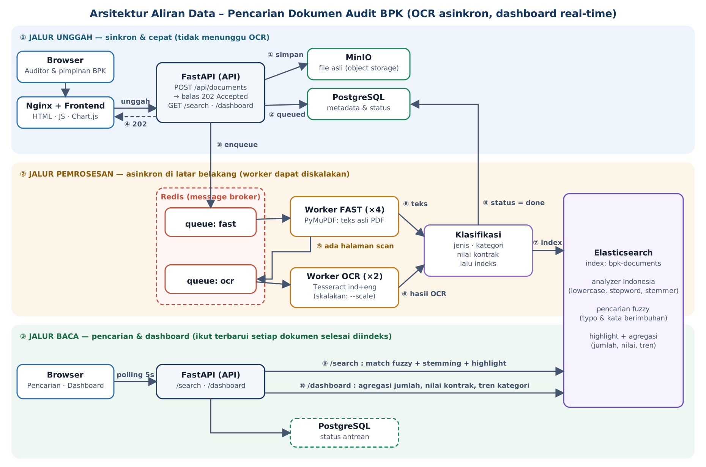

# Pencarian Dokumen Audit BPK — Implementasi Arsitektur Studi Kasus

Implementasi lengkap (berbasis Docker) untuk studi kasus: **pencarian isi dokumen audit**
(PDF asli maupun hasil scan), **toleran kata berimbuhan & salah ketik**, **dashboard per lembaga
yang ikut terbarui otomatis**, serta **OCR berat yang tidak membuat unggahan lambat/timeout**.

> Semua data contoh bersifat **fiktif** dan dibuat oleh seeder untuk keperluan demo.

---

## 1. Masalah → Solusi

| Kebutuhan studi kasus | Solusi pada sistem ini |
|---|---|
| Ribuan dokumen/hari, sebagian PDF asli, sebagian scan | Unggah → object storage (MinIO). Pipeline mendeteksi per halaman: ada teks asli → langsung dipakai; tidak ada → OCR |
| Cari kata bebas di **seluruh isi** dokumen | Seluruh teks diindeks ke **Elasticsearch** (bukan hanya judul/metadata) |
| Tetap relevan untuk kata berimbuhan (`konsultasi` ↔ `konsultan`) | Analyzer **bahasa Indonesia** (lowercase, stopword, *stemmer* Indonesia) |
| Tetap relevan untuk salah ketik (`blanja modaal`) | Query **fuzzy** (`fuzziness: AUTO`) pada field ber-stemming **dan** field tanpa stemming |
| Dashboard per lembaga: jumlah dokumen, total nilai kontrak, tren kategori | **Agregasi Elasticsearch** (sum, terms, date_histogram) + status antrean dari PostgreSQL |
| Dashboard update otomatis tiap ada dokumen baru | Dokumen diindeks begitu selesai diproses; frontend *polling* tiap 5 detik |
| OCR berat tidak boleh memperlambat unggah | **Unggah asinkron**: API hanya simpan file + catat + antre, lalu balas `202 Accepted`. OCR berjalan di **worker terpisah** pada **antrean terpisah** |

---

## 2. Arsitektur Aliran Data



*(Versi vektor: [`docs/arsitektur.svg`](docs/arsitektur.svg))*

### Penjelasan alur (sesuai nomor pada gambar)

**① – ④ Jalur unggah (sinkron, cepat)**
1. Browser mengirim file ke `POST /api/documents` (lewat Nginx).
2. API menyimpan file asli ke **MinIO** (①), mencatat metadata + `status=queued` di **PostgreSQL** (②),
   lalu mengirim tugas ke **Redis** antrean `fast` (③).
3. API langsung membalas **`202 Accepted`** (④). Tidak ada OCR/indeks di dalam request ini,
   sehingga waktu unggah tidak bergantung pada beratnya pemrosesan.

**⑤ – ⑧ Jalur pemrosesan (asinkron)**
4. **Worker FAST** mengambil tugas, mengunduh file dari MinIO, lalu mengekstrak **teks asli PDF**
   (PyMuPDF — sangat cepat).
5. Jika ada halaman tanpa teks (hasil scan/gambar), tugas dilempar ke antrean **`ocr`** (⑤) dan
   worker FAST langsung bebas untuk dokumen berikutnya.
6. **Worker OCR** (Tesseract, bahasa `ind+eng`) hanya meng-OCR halaman yang memang kosong teks, lalu
   menyerahkan hasilnya (⑥).
7. Teks dianalisis (jenis dokumen, kategori belanja, nilai kontrak) dan diindeks ke **Elasticsearch** (⑦),
   lalu status di PostgreSQL menjadi `done` (⑧).

**⑨ – ⑩ Jalur baca**
- `GET /api/search` → query fuzzy + stemming + *highlight* (⑨).
- `GET /api/dashboard` → agregasi (jumlah, total nilai kontrak, tren kategori per interval) (⑩) digabung
  dengan status antrean dari PostgreSQL. Frontend memanggilnya tiap 5 detik sehingga angka/grafik
  berubah sendiri saat dokumen baru selesai diproses.

### Mengapa dua antrean (`fast` dan `ocr`)?
OCR memakan CPU dan waktu (detik–menit per dokumen). Bila semua dokumen berbagi satu antrean, PDF
berteks yang ringan ikut menunggu di belakang OCR. Dengan antrean terpisah, dokumen ringan tetap
cepat muncul di pencarian, sedangkan kapasitas OCR dapat diskalakan sendiri:

```bash
docker compose up -d --scale worker-ocr=3
```

### Keandalan pipeline
- `acks_late` + `reject_on_worker_lost`: tugas tidak hilang bila worker mati di tengah proses.
- *Retry* otomatis dengan backoff; bila tetap gagal, status dokumen menjadi `failed` + pesan error.
- Tugas bersifat **idempoten** (ID dokumen sebagai `_id` Elasticsearch) sehingga aman diulang.
- Broker Redis memakai `appendonly` agar antrean bertahan saat restart.

---

## 3. Komponen & Teknologi

| Layanan | Teknologi | Fungsi | Port host |
|---|---|---|---|
| `frontend` | Nginx + HTML/JS + Chart.js (disertakan lokal) | UI pencarian, dashboard, unggah; *reverse proxy* `/api` | **8080** |
| `api` | FastAPI (Python) | Unggah, pencarian, dashboard, unduh dokumen | 8000 (`/docs`) |
| `worker-fast` | Celery | Ekstraksi teks asli PDF, klasifikasi, indeks | – |
| `worker-ocr` | Celery + Tesseract | OCR halaman scan, klasifikasi, indeks | – |
| `redis` | Redis 7 | Message broker (antrean `fast`, `ocr`) | – |
| `postgres` | PostgreSQL 16 | Metadata & status dokumen | – |
| `minio` | MinIO | Penyimpanan file asli | 9001 (konsol) |
| `elasticsearch` | Elasticsearch 8.17 | Indeks teks penuh & agregasi dashboard | 9200 |

### Struktur folder
```
bpk-audit-search/
├── docker-compose.yml
├── README.md
├── docs/                 # diagram arsitektur (SVG & PNG)
├── db/init.sql           # skema PostgreSQL
├── nginx/default.conf    # proxy /api -> FastAPI
├── frontend/             # index.html, app.js, style.css, vendor/chart.umd.js
└── backend/
    ├── Dockerfile        # python + tesseract (ind, eng)
    ├── requirements.txt
    └── app/
        ├── main.py       # endpoint API
        ├── tasks.py      # pipeline Celery (fast -> ocr -> indeks)
        ├── extract.py    # PyMuPDF + Tesseract
        ├── classify.py   # jenis dokumen, kategori, nilai kontrak
        ├── search.py     # mapping/analyzer ES, query fuzzy, agregasi
        ├── storage.py    # MinIO
        ├── db.py         # PostgreSQL
        └── seed.py       # generator dokumen contoh (teks + scan)
```

---

## 4. Cara Menjalankan

### Prasyarat
- Docker + Docker Compose v2
- RAM kosong ± **3 GB** (Elasticsearch memakai heap 512 MB)
- Linux (host Docker native): Elasticsearch membutuhkan
  `sudo sysctl -w vm.max_map_count=262144` (Docker Desktop Windows/macOS biasanya sudah memadai)

### Langkah
```bash
unzip bpk-audit-search.zip && cd bpk-audit-search

# 1) Build & jalankan semua layanan (build pertama ± beberapa menit)
docker compose up -d --build

# 2) Pastikan semua sehat (tunggu Elasticsearch ± 30-60 detik)
docker compose ps

# 3) Isi data contoh: 40 dokumen, ± 35% hasil scan (butuh OCR)
docker compose exec api python -m app.seed --count 40
```

Buka:
- **Aplikasi**: <http://localhost:8080>
- Dokumentasi API (Swagger): <http://localhost:8000/docs>
- Konsol MinIO: <http://localhost:9001> (`minioadmin` / `minioadmin`)

Memantau pipeline:
```bash
docker compose logs -f worker-fast worker-ocr
```

Menghentikan:
```bash
docker compose down        # data tetap tersimpan di volume
docker compose down -v     # hapus semua data
```

---

## 5. Cara Memakai & Skenario Uji

### a. Pencarian (tab *Pencarian*)
Coba kata kunci berikut dan perhatikan hasil tetap relevan beserta *highlight*:

| Ketik | Yang diuji |
|---|---|
| `bahan bakar` | pencarian isi dokumen (bukan judul) |
| `jasa konsultasi` | dokumen berisi *konsultan / konsultansi* |
| `blanja modaal` | salah ketik → `belanja modal` |
| `pengadaan gedung` | frasa persis naik peringkat |

Dokumen bertanda **hasil OCR** adalah PDF scan yang teksnya diperoleh Tesseract — tetap dapat dicari.
Filter lembaga/kategori/jenis tersedia di atas hasil.

### b. Dashboard (tab *Dashboard Lembaga*)
Pilih lembaga (atau semua). Tampil: dokumen masuk, terindeks, **total nilai kontrak**, antrean,
**tren kategori belanja** (harian/mingguan/bulanan), komposisi kategori, dan rekap per lembaga.
Biarkan tab terbuka lalu jalankan seeder lagi → angka & grafik berubah sendiri dalam ≤ 5 detik.

### c. Unggah (tab *Unggah & Antrean*)
Unggah PDF/gambar sendiri. Perhatikan pesan **"diterima dalam … ms"**: tetap singkat walau file
perlu OCR. Tabel di bawahnya menampilkan status langsung:
`Antre → Diproses → (Menunggu OCR) → Selesai`.

### d. Uji unggah lewat cURL
```bash
curl -s -w '\nwaktu: %{time_total}s\n' -X POST http://localhost:8000/api/documents \
  -F "files=@dokumen.pdf" -F "institution=Kementerian Kesehatan" -F "doc_date=2026-10-01"

curl -s "http://localhost:8000/api/search?q=blanja%20modaal" | python3 -m json.tool | head -40
curl -s "http://localhost:8000/api/dashboard?institution=Kementerian%20Kesehatan" | python3 -m json.tool | head -40
```

---

## 6. Ringkasan API

| Method & path | Keterangan |
|---|---|
| `POST /api/documents` | multipart: `files` (banyak), `institution`, `doc_date` (opsional). Balas **202** |
| `GET /api/documents?institution=&limit=` | Dokumen terbaru + status pemrosesan |
| `GET /api/documents/{id}/download` | Unduh/tampilkan file asli |
| `GET /api/search?q=&institution=&category=&doc_type=&page=&size=` | Pencarian teks penuh (fuzzy + stemming) + *highlight* |
| `GET /api/dashboard?institution=&interval=day\|week\|month` | KPI, tren, komposisi, rekap per lembaga, status pipeline |
| `GET /api/institutions` | Daftar lembaga |

---

## 7. Detail Desain Penting

**Analyzer & pencarian (Elasticsearch)** — field `content` memakai `id_text`
(`standard` → `lowercase` → `asciifolding` → stopword Indonesia → stemmer Indonesia) dan sub-field
`content.plain` tanpa stemming. Query `bool.should` menggabungkan: (1) match ber-stemming + fuzzy,
(2) match tanpa stemming + fuzzy, (3) `match_phrase` (boost) dan (4) nama file.
Stemmer menangani imbuhan; fuzzy (jarak edit maks. 2 untuk kata ≥ 6 huruf) menangani salah ketik;
kedua jalur saling menutup kekurangan (mis. `konsultasi` ↔ `konsultan` ditangkap oleh fuzzy).

**Deteksi OCR per halaman** — halaman dengan teks asli < 40 karakter dianggap scan
(`MIN_CHARS_PER_PAGE`). PDF campuran hanya di-OCR pada halaman yang perlu.

**Metadata otomatis** (`classify.py`) — jenis dokumen (Kontrak/Nota/Laporan Realisasi), kategori belanja
(Bahan Bakar, Jasa Konsultan, Belanja Modal, dst.), dan nilai kontrak (angka `Rp …` pada baris
berpetunjuk "nilai kontrak/sebesar", fallback angka terbesar) diekstrak berbasis aturan. Aturan ini
sengaja sederhana agar mudah dibaca; di produksi dapat diganti model klasifikasi/NER.

**Dashboard real-time** — tidak ada proses *batch* terpisah: karena angka dihitung langsung dari
agregasi indeks, setiap dokumen yang selesai diindeks otomatis ikut terhitung. Frontend memakai
*polling* 5 detik (cukup untuk kebutuhan ini; WebSocket/SSE dapat ditambahkan bila perlu).

---

## 8. Konfigurasi (variabel lingkungan)

Diatur di `docker-compose.yml` (anchor `x-backend`) dan `backend/app/config.py`:

| Variabel | Default | Arti |
|---|---|---|
| `MAX_UPLOAD_MB` | 50 | Batas ukuran per file |
| `MIN_CHARS_PER_PAGE` | 40 | Ambang halaman dianggap scan |
| `OCR_DPI` | 200 | Resolusi render halaman sebelum OCR |
| `OCR_LANG` | `ind+eng` | Bahasa Tesseract |
| `MAX_INDEX_CHARS` | 1500000 | Batas karakter teks per dokumen yang diindeks |

Konkurensi worker: ubah `-c` pada `worker-fast` / `worker-ocr` di `docker-compose.yml`,
atau tambah replika dengan `--scale`.

---

## 9. Pemecahan Masalah

| Gejala | Penanganan |
|---|---|
| `elasticsearch` restart / *max virtual memory areas* | Linux: `sudo sysctl -w vm.max_map_count=262144` lalu `docker compose up -d` |
| `elasticsearch` selalu *unhealthy* | Beri RAM lebih ke Docker (≥ 3 GB) dan tunggu ± 1 menit |
| Port 8080/8000/9200 bentrok | Ubah pemetaan `ports` pada `docker-compose.yml` |
| Dokumen lama di status `Antre` | Cek `docker compose logs worker-fast worker-ocr`; pastikan keduanya *Up* |
| Hasil OCR kurang akurat | Naikkan `OCR_DPI` (mis. 300); kualitas scan sangat memengaruhi hasil |
| Ingin mulai dari nol | `docker compose down -v && docker compose up -d --build` |

---

## 10. Keterbatasan & Pengembangan Lanjutan

- Satu node Elasticsearch tanpa replika dan tanpa autentikasi — **hanya untuk demo/pengembangan**.
  Produksi: klaster ES (≥ 3 node), TLS + autentikasi, kredensial lewat *secret*, MinIO/S3 terkelola.
- Klasifikasi/ekstraksi nilai kontrak berbasis aturan; akurasi untuk format dokumen yang beragam dapat
  ditingkatkan dengan model NER/LLM.
- Belum ada autentikasi pengguna/otorisasi per lembaga; tambahkan (mis. OIDC) sebelum dipakai nyata.
- Skala besar (ribuan dokumen/hari terus-menerus): tambahkan replika `worker-ocr`, pisahkan node worker
  OCR (CPU), dan pertimbangkan antrean berprioritas atau Kafka bila butuh *replay* & integrasi lebih luas.
- Alur pembaruan indeks dapat dibuat berbasis *change-data-capture* (mis. Debezium) bila sumber
  kebenarannya dipindah ke basis data transaksional.
